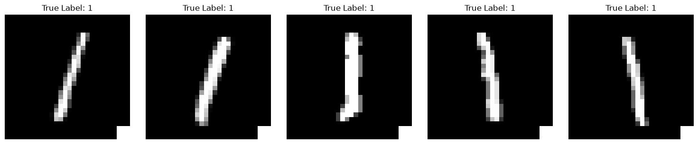
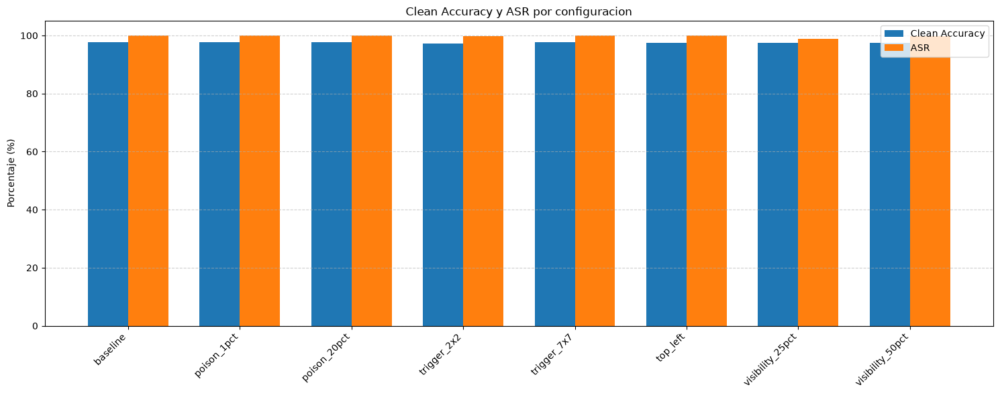
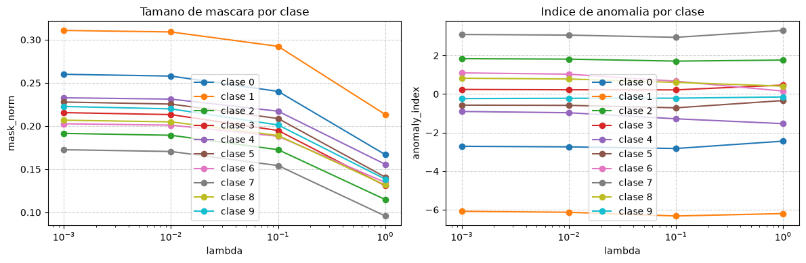

[English](README.md) | **Español**

# Backdoors con BadNets, clean-label poisoning y detección con Neural Cleanse

Ataques de envenenamiento de datos sobre redes neuronales y cómo detectarlos:

- **BadNets** (Gu et al. 2017) sobre MNIST: un trigger en la esquina hace que cualquier "1" se clasifique como "7".
- **Clean-label poisoning** tipo *Poison Frogs* (Shafahi et al. 2018) sobre CIFAR-10 con una ResNet-18, sin tocar ni una etiqueta.
- **Neural Cleanse** (Wang et al. 2019) para detectar qué clase tiene la puerta trasera.

## Contenido

- `notebooks/P3-Src1.ipynb`: BadNets, los experimentos variando poison rate y trigger, y Neural Cleanse. El ataque BadNets base venía de la asignatura; las variantes (`add_trigger_v2`, `BadNetMNIST_v2`), los experimentos y la implementación de Neural Cleanse son míos.
- `notebooks/P3-Src2.ipynb`: clean-label poisoning con `FeatureCollisionAttack` de la Adversarial Robustness Toolbox (ART).
- `entrega/p3a.pdf`: parte teórica (poisoning vs backdoor, triggers, clean-label, métricas de BadNets, Neural Cleanse).
- `entrega/p3b.pdf`: análisis del código y de los resultados.

## BadNets

Un ataque de data poisoning normal cambia labels o mete imágenes incorrectas y degrada el rendimiento. Un backdoor no: se incluyen imágenes con un trigger sutil (aquí un cuadrado en la esquina inferior derecha) y con la etiqueta cambiada, y la red aprende a asociar ese trigger con la clase falsa. Por eso no baja la accuracy ni crea sesgos, solo se comporta de forma distinta con ese input concreto, y con evaluaciones de rendimiento normales no se detecta.



Con un 5% de los "1" envenenados (337 imágenes):

| | Accuracy limpia | ASR |
|---|---|---|
| Modelo limpio | 97.72% | - |
| Modelo con backdoor | 97.72% | 100% |

La accuracy es exactamente la misma. Luego probé a cambiar el poison rate (1% y 20%), el tamaño del trigger (2x2, 3x3, 7x7), la posición y la visibilidad (25% y 50% de intensidad):



En MNIST el ataque funciona prácticamente en todas: con solo un 1% de envenenamiento ya da un 99.91% de ASR. El trigger más pequeño tiene un ASR un poco menor pero sigue siendo efectivo, el de 7x7 es más fácil de detectar visualmente y el de 3x3 es el más equilibrado. En un caso real donde haya que capturar el trigger con una cámara, uno más grande igual es mejor opción, porque es más fácil de capturar desde diferentes ángulos y más invariable a transformaciones.

## Clean-label poisoning (Poison Frogs)

Aquí las etiquetas siguen siendo las correctas. Se escoge una clase base (frog) y una instancia objetivo (un bird), y se crean muestras que visualmente para un humano son ranas, pero que en el espacio latente del modelo están pegadas al bird.

Cuando se reentrena con esas muestras, el humano que las revisa ve una rana y la etiqueta es frog, así que el modelo aprende que unas características propias de bird corresponden a frog, y arrastra al bird objetivo a la región de frog. Antes del ataque el modelo dice bird, después dice frog, y si revisas el dataset todo parece estar bien. Por eso es tan peligroso.

## Neural Cleanse

En lugar de buscar en los datos, hace ingeniería inversa desde el modelo: para cada clase busca con descenso de gradiente la máscara y el patrón más pequeños que hacen que imágenes de otras clases se clasifiquen como esa. Si una clase necesita una máscara mucho más pequeña que las demás, es sospechosa, porque en un modelo limpio para pasar de una clase a otra hace falta cambiar bastantes píxeles. Para decidir qué es "mucho más pequeña" se usa la MAD (*Median Absolute Deviation*), la mediana y no la media, porque si hay un trigger muy pequeño la media se movería.



Lo probé con distintos valores de lambda (regularización del tamaño de la máscara) y en todas las configuraciones la clase 7, que es la del backdoor, sale como la de máscara anómala.

## Mitigación

Contra clean-label la defensa tiene que ir por el lado de los datos: verificar la procedencia y el control de acceso del dataset, detectar ejemplos atípicos con embeddings, vecinos cercanos y clustering, auditar duplicados y muestras casi idénticas, entrenamiento robusto con augmentations fuertes y pruebas de backdoor como Neural Cleanse. Si se identifica un cluster o trigger sospechoso se eliminan o aíslan esas muestras y se reentrena; no se debe cambiar automáticamente la etiqueta sin evidencia.

## Cómo ejecutarlo

```bash
pip install -r requirements.txt
```

MNIST y CIFAR-10 se descargan solos con torchvision. La variable `BASE_PATH` de los notebooks apunta a la carpeta donde yo trabajaba, hay que cambiarla a la vuestra.

## Referencias

- Gu, Dolan-Gavitt, Garg. *BadNets: Identifying Vulnerabilities in the Machine Learning Model Supply Chain*. 2017. [arXiv:1708.06733](https://arxiv.org/abs/1708.06733)
- Shafahi et al. *Poison Frogs! Targeted Clean-Label Poisoning Attacks on Neural Networks*. NeurIPS 2018. [arXiv:1804.00792](https://arxiv.org/abs/1804.00792)
- Wang et al. *Neural Cleanse: Identifying and Mitigating Backdoor Attacks in Neural Networks*. IEEE S&P 2019.
- [Adversarial Robustness Toolbox](https://github.com/Trusted-AI/adversarial-robustness-toolbox)
