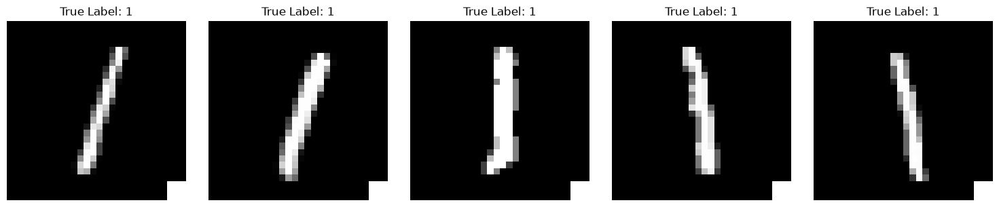
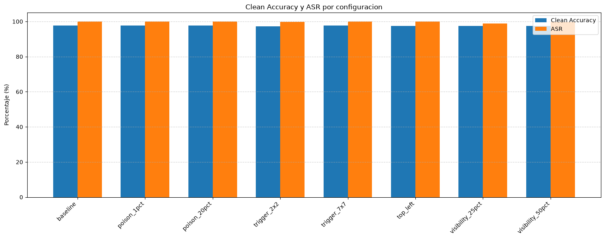
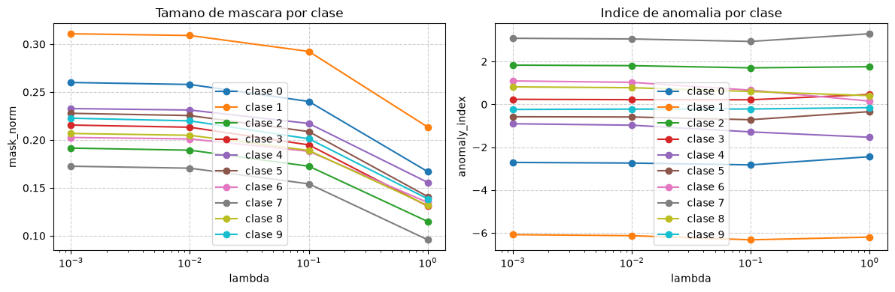

**English** | [Español](README.es.md)

# Backdoors with BadNets, clean-label poisoning and detection with Neural Cleanse

Data poisoning attacks on neural networks and how to detect them:

- **BadNets** (Gu et al. 2017) on MNIST: a trigger in the corner makes any "1" get classified as "7".
- **Clean-label poisoning** in the style of *Poison Frogs* (Shafahi et al. 2018) on CIFAR-10 with a ResNet-18, without touching a single label.
- **Neural Cleanse** (Wang et al. 2019) to detect which class has the backdoor.

## Contents

- `notebooks/P3-Src1.ipynb`: BadNets, the experiments changing poison rate and trigger, and Neural Cleanse. The base BadNets attack came from the course; the variants (`add_trigger_v2`, `BadNetMNIST_v2`), the experiments and the Neural Cleanse implementation are mine.
- `notebooks/P3-Src2.ipynb`: clean-label poisoning with `FeatureCollisionAttack` from the Adversarial Robustness Toolbox (ART).
- `entrega/p3a.pdf`: theory part (poisoning vs backdoor, triggers, clean-label, BadNets metrics, Neural Cleanse).
- `entrega/p3b.pdf`: analysis of the code and the results.

The reports are in Spanish.

## BadNets

A normal data poisoning attack changes labels or adds wrong images and degrades performance. A backdoor doesn't: images with a subtle trigger (here a square in the bottom right corner) and a changed label are added, and the network learns to associate that trigger with the fake class. That's why accuracy doesn't drop and no bias is created, it only behaves differently with that specific input, and it can't be detected with normal performance evaluations.



With 5% of the "1"s poisoned (337 images):

| | Clean accuracy | ASR |
|---|---|---|
| Clean model | 97.72% | - |
| Backdoored model | 97.72% | 100% |

The accuracy is exactly the same. Then I tried changing the poison rate (1% and 20%), the trigger size (2x2, 3x3, 7x7), the position and the visibility (25% and 50% intensity):



On MNIST the attack works in basically all of them: with only 1% poisoning it already gets 99.91% ASR. The smallest trigger has a slightly lower ASR but it's still effective, the 7x7 one is easier to spot visually and the 3x3 one is the most balanced. In a real case where the trigger has to be captured by a camera, a bigger one might be a better option, because it's easier to capture from different angles and more invariant to transformations.

## Clean-label poisoning (Poison Frogs)

Here the labels stay correct. You pick a base class (frog) and a target instance (a bird), and create samples that visually, for a human, are frogs, but in the latent space of the model are right next to the bird.

When the model is retrained with those samples, the human reviewing them sees a frog and the label is frog, so the model learns that features that belong to bird correspond to frog, and drags the target bird into the frog region. Before the attack the model says bird, after it says frog, and if you check the dataset everything looks fine. That's why it's so dangerous.

## Neural Cleanse

Instead of looking at the data, it does reverse engineering from the model: for each class it uses gradient descent to find the smallest mask and pattern that make images from other classes get classified as that class. If a class needs a much smaller mask than the rest, it's suspicious, because in a clean model you need to change quite a lot of pixels to go from one class to another. To decide what "much smaller" means it uses MAD (*Median Absolute Deviation*), the median and not the mean, because if there's a really small trigger the mean would shift.



I tried it with different lambda values (regularization of the mask size) and in every configuration class 7, the backdoor class, comes out as the one with the anomalous mask.

## Mitigation

Against clean-label the defence has to be on the data side: verify the provenance and access control of the dataset, detect outliers with embeddings, nearest neighbours and clustering, audit duplicates and near identical samples, robust training with strong augmentations, and backdoor tests like Neural Cleanse. If a suspicious cluster or trigger is found, those samples are removed or isolated and the model is retrained; labels shouldn't be changed automatically without evidence.

## How to run it

```bash
pip install -r requirements.txt
```

MNIST and CIFAR-10 are downloaded automatically by torchvision. The `BASE_PATH` variable in the notebooks points to the folder where I was working, change it to yours.

## References

- Gu, Dolan-Gavitt, Garg. *BadNets: Identifying Vulnerabilities in the Machine Learning Model Supply Chain*. 2017. [arXiv:1708.06733](https://arxiv.org/abs/1708.06733)
- Shafahi et al. *Poison Frogs! Targeted Clean-Label Poisoning Attacks on Neural Networks*. NeurIPS 2018. [arXiv:1804.00792](https://arxiv.org/abs/1804.00792)
- Wang et al. *Neural Cleanse: Identifying and Mitigating Backdoor Attacks in Neural Networks*. IEEE S&P 2019.
- [Adversarial Robustness Toolbox](https://github.com/Trusted-AI/adversarial-robustness-toolbox)
